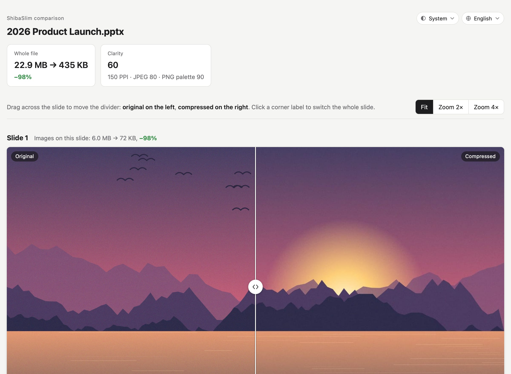

<p align="center">
  
</p>

<h1 align="center">ShibaSlim</h1>

<p align="center">
  <b>Shrink the images in your PowerPoint files to just what they need</b><br>
  Much smaller files, no visible difference, and text, layout and animations untouched.
</p>

<p align="center">
  
  
  
</p>

<p align="center">
  <a href="README.md">简体中文</a> · <b>English</b>
</p>

<p align="center">
  <picture>
    <source media="(prefers-color-scheme: dark)" srcset="docs/gui-en-dark.png">
    
  </picture>
  <br>
  <sub>The files in the screenshot are generated demo decks; real savings depend on the original images.</sub>
</p>

> [!NOTE]
> The interface and the comparison page follow your system language (Chinese or English) and theme. Command-line messages are currently in Chinese only.

## Features

- **Sized to how images are shown**: works out how large each image actually appears on its slides and keeps only the pixels needed, accounting for crops and group scaling.
- **One clarity setting**: a single number from 1 to 100 sets resolution, JPEG quality and PNG colour reduction together.
- **Before/after comparison**: picks a few random slides and lets you drag a divider between the original and the compressed version, with up to 4× zoom.
- **Slides as pictures**: saves every slide (or just the cover, or the slides you name) as a PNG or JPG at the width you choose, drawn by PowerPoint or WPS on Windows, and by PowerPoint or, without it, the built-in Quick Look on a Mac.
- **Desktop app, web page and CLI**: install the app and double-click, with no Node.js needed, and share it as a single file; or use it in a browser, or batch-process folders from the command line.
- **Online updates**: the desktop app looks for a new version when it starts; one click downloads it, installs it and reopens the app.
- **Light or dark, Chinese or English**: the pages follow your system's theme and language by default, and you can switch either at the top right; your choice is remembered.
- **Your files are safe**: originals are left alone by default and results are saved as new files; the graphical interface never overwrites an existing file. Every result is re-read and checked before it is written.
- **Optional attribution**: writes the author and company into the file properties, appends it to the name of every shape in the selection pane, and signs the result with this computer's key, so you can later check whether a file changed after signing.
- **Runs locally**: nothing is uploaded to the internet. Works on macOS, Windows and Linux.

## Quick start

### Desktop app (recommended)

Download the installer for your system from [Releases](https://github.com/Wonvy/ShibaSlim/releases) and open ShibaSlim like any other app. Nothing else, not even Node.js, needs to be installed.

| System | Which file |
|---|---|
| macOS · Apple silicon (M1 and later) | the `.dmg` with `aarch64` in its name |
| macOS · Intel | the `.dmg` with `x64` in its name |
| Windows 10 / 11 | `x64-setup.exe` |
| Linux | `.AppImage` (runs as is) or `.deb` (Debian / Ubuntu package) |

> [!IMPORTANT]
> The installers are not yet notarized by Apple or code-signed for Windows, so the system stops the first launch. Allow it once and it will not ask again:
> - **macOS**: when it says the app cannot be opened, click **Done**, then go to **System Settings → Privacy & Security** and click **Open Anyway** near the bottom.
> - **Windows**: when you see "Windows protected your PC", click **More info → Run anyway**.
> - **Linux**: make the AppImage executable (`chmod +x`) before running it; if it complains about FUSE, install `libfuse2` (`libfuse2t64` from Ubuntu 24.04 on).

### From source (in a browser)

Install [Node.js](https://nodejs.org) 20.9 or later first.

```bash
git clone https://github.com/Wonvy/ShibaSlim.git
cd ShibaSlim
npm install
```

Then open the interface either way:

| How | What to do |
|---|---|
| Double-click | `ShibaSlim.command` on macOS, `ShibaSlim.cmd` on Windows, or run `ShibaSlim.sh` on Linux |
| Command line | `npm run gui` |

> [!TIP]
> The double-click launchers run `npm install` on first use, so you can also double-click them straight after downloading. If macOS says it cannot verify the developer, right-click the file and choose Open.

## Graphical interface

The ShibaSlim page opens in your browser:

1. Drag PowerPoint files or whole folders onto the page, or use **Choose files** / **Choose folder**. Folders are added with all their sub-folders.
2. Under **What to do**, tick any combination of **Compress images**, **Add attribution** and **Save slides as pictures**: pictures alone, say, or compressing and attributing together.
3. When compressing, move the **Clarity** slider, or pick **Small**, **Everyday** or **High**. To check the result first, click **Compare** next to a file; this is only a trial run and saves nothing.
4. Click **Start**. When a file is done, use **Download**, or **Show** to find it in its folder.

Attribution needs an author (the company is optional); see [Attribution](#attribution-optional). For pictures you can set the width (1280, 1920, 2560, 3840 or any number of pixels), the format (PNG or JPG) and which slides (all, the cover only, or numbers such as `1-3, 5`); see [Slides as pictures](#slides-as-pictures). To save one file's pictures right away, click **Pictures** next to it.

After a setting changes, finished files show "Settings changed, ready to run again", and **Start** redoes them with the new settings.

The desktop app shows the same interface with a few differences: results go next to the originals by default (see below); **Compare** is built in the background first and then opens in a new window; results are already saved where they belong, where **Show** finds them, so there is no **Download** button; and closing the window quits, so instead of **Quit** there is **Check for updates**. Its window, menus and dialogs also follow the system's language and light or dark appearance.

The desktop app looks for a new version each time it starts. If there is one, it asks; click **Update Now** and it downloads, installs and reopens itself. To check right away, click **Check for updates** at the top right, or on macOS choose **ShibaSlim → Check for Updates…**.

The switches at the top right set the theme (System / Light / Dark) and language (System / 中文 / English). Both follow the system by default and change along with it; a choice you make is remembered, and the comparison page uses it too.

The desktop app saves results in a **`ShibaSlim` folder next to each original** by default, and leaves the original alone:

```
project/
├── report.pptx              ← the original
└── ShibaSlim/
    ├── report.slim.pptx     ← compressed (and attributed)
    └── report-slides/       ← slide pictures
        ├── 01.png
        └── 02.png
```

Under **Save to** you can switch to **This folder** to put every result in one folder instead; dropped folders then keep their structure. The browser version (`shibaslim gui`) cannot learn where a file came from, so it always saves to a folder, `Downloads/ShibaSlim` by default.

Compressed results get `.slim` added to their names (`report.pptx` → `report.slim.pptx`) and attributed-only ones `.signed`, so they cannot be mixed up with the originals. If a file of that name is already there, the result is saved as `report.slim (2).pptx`; existing files are never overwritten.

> [!NOTE]
> The page is served only on `127.0.0.1` and its address carries a one-time access token, so other computers and other websites cannot reach it. Dropped files are copied to the system temp folder and deleted when you quit. Click **Quit** at the top right when you are done, or simply close the terminal window.

`shibaslim gui` takes two options: `--port <port>` to choose the port (51735 by default, or any free port if that one is taken) and `--no-browser` to print the address without opening a browser.

## Comparison page

<p align="center">
  <picture>
    <source media="(prefers-color-scheme: dark)" srcset="docs/compare-en-dark.jpg">
    
  </picture>
</p>

The comparison page picks a few random slides whose images changed and draws the images where they sit on each slide. **The original is on the left and the compressed version on the right**; drag anywhere on the slide to move the divider.

- Zoom to 2× or 4×; the view centres on the divider.
- Click **Original** at the top left or **Compressed** at the top right to switch the whole slide. Flicking between them is the easiest way to spot a difference.
- With the slide focused, <kbd>←</kbd> <kbd>→</kbd> move the divider (hold <kbd>Shift</kbd> for fine steps) and <kbd>Home</kbd> / <kbd>End</kbd> jump to either side.
- A table under each slide lists every image's size before and after.
- The page is a single self-contained HTML file with the images embedded, so you can send it to someone; it opens in their own system's theme and language.

> [!NOTE]
> Only images are drawn. Text, shapes and charts are identical before and after, so they are left out and the page looks emptier than the real slide.

## Slides as pictures

Tick **Save slides as pictures** in the graphical interface and click **Start** (or click **Pictures** next to a file for just that one), or run `shibaslim images`, to save the slides as pictures in a `<name>-slides` folder, named by slide number (`report.pptx` → `report-slides/01.png, 02.png…`). The graphical interface puts that folder with the other results (in the desktop app, the `ShibaSlim` folder next to the original by default); the command line puts it next to the original by default. The pictures are of the original file, not the compressed one, and hidden slides are included and keep their numbers.

To save only some slides, pick **Cover only** or **These** (such as `1-3, 5`) in the graphical interface, or pass `-p 1` or `-p 1-3,5` on the command line. Pictures keep their slide numbers: slides 2 and 5 give `02.png` and `05.png`. Numbers past the last slide are ignored.

A pptx holds no pictures of its slides, so a program has to draw them. ShibaSlim uses the best one this computer has, and moves on to the next if it fails:

| System | Drawn by | Notes |
|---|---|---|
| Windows | Microsoft PowerPoint, then WPS Office | One of them must be installed; the result matches saving as pictures from PowerPoint |
| macOS | Microsoft PowerPoint, when installed | Saved as a PDF first, then drawn at the width you ask for. The first time, macOS asks whether ShibaSlim may control PowerPoint, and PowerPoint may ask for access to `~/Library/Caches/ShibaSlim/PowerPoint`; allow both and you will not be asked again |
| macOS | The built-in Quick Look | Nothing to install, and fast. Close to PowerPoint, but some picture effects (such as greyscale) and transparency are lost |
| Linux | Not supported yet | |

PowerPoint and WPS open a temporary copy in the background, so the original is never touched, and quit afterwards if they were not already running.

```bash
shibaslim images report.pptx                       # report-slides/01.png, 02.png…
shibaslim images ./decks -r -w 1280 --format jpg   # a whole folder, as 1280-pixel-wide JPGs
shibaslim images report.pptx -p 1                  # the cover only
shibaslim images report.pptx --renderer quicklook  # use Quick Look
```

| Option | Description |
|---|---|
| `-w, --width <pixels>` | Picture width, default 1920 (1920×1080 for a 16:9 slide); the height follows the slide's proportions |
| `--format <png\|jpg>` | Picture format, default png |
| `-q, --quality <1-100>` | JPG quality, default 90 |
| `-p, --pages <numbers>` | Save only these slides, such as `1` or `1-3,5`; all by default |
| `--renderer <name>` | Use only this one: `powerpoint`, `wps` or `quicklook` |
| `-o, --out-dir <dir>` | Output folder (keeps the sub-folder structure); by default next to the original |
| `-r, --recursive` / `--json` | Include sub-folders / print results as JSON |

Exporting the same file again from the command line replaces the pictures in its `<name>-slides` folder (only numbered ones such as `01.png`; other files are left alone). The graphical interface, as with compressed results, never writes into a folder it did not make in this session, and uses `report-slides (2)` instead.

## Clarity

| Clarity | Pixel density | JPEG quality | PNG | Good for |
|:---:|:---:|:---:|:---:|---|
| 30 · Small | 96 PPI | 68 | Reduced colours, quality 70 | Email attachments, just legible |
| **60 · Everyday (default)** | **150 PPI** | **80** | **Reduced colours, quality 90** | **Projectors, ordinary screens, sharing** |
| 85 · High | 220 PPI | 88 | Lossless | High-resolution displays, zooming in on detail |
| 100 | 330 PPI | 95 | Lossless | Barely downsampled; only invisible re-encoding |

Values in between are interpolated linearly, and from 85 up PNG is always lossless. Pixel density means how many pixels are kept for the size an image is **actually shown** on the slide: at 150 PPI a 16:9 slide is about 2000×1125, plenty for a 1080p projector.

> [!TIP]
> Not sure what to pick? Generate a comparison page at the default of 60, then go up or down from there.

## Attribution (optional)

Tick **Add attribution** in the interface and enter an author (the company is optional), or pass `--author` on the command line, and each result gains three things:

| Where | What | Where you see it |
|---|---|---|
| File properties (`docProps/core.xml`, `docProps/app.xml`) | Author, last saved by, company | Windows: right-click → Properties → Details; PowerPoint: File → Info; macOS Spotlight (`mdls file.pptx`) |
| Every slide's selection pane (`ppt/slides/*.xml`) | ` · © Jane Doe` after the name of every shape, such as `Picture 3 · © Jane Doe`, groups and the shapes in them included | PowerPoint: Home → Arrange → Selection Pane (<kbd>Alt</kbd>+<kbd>F10</kbd>); the animation pane shows the same names |
| Presentation tags (`ppt/tags/*.xml`) | Author, time of signing, public key and an Ed25519 signature | Not shown anywhere; checked with ShibaSlim |

No shapes are added, only names change, so slide shows and printouts look exactly the same. Animations refer to shapes by number, so they are unaffected; Morph pairs shapes across slides by name, and every name gets the same ending, so the pairs stay the same too. Attributing a file again replaces the attribution at the end of each name rather than adding another. This holds even when an earlier attribution was reworded (a full-width ・ for the dot, spaces lost) or a name already holds several: one new attribution is left. A © with no dot before it, as in `© 2024 Logo`, is part of the name and stays. Attributing again also removes the hidden attribution shape version 0.2.0 put on every slide. Shapes on masters and layouts keep their names.

Macros in a `.pptm` that look shapes up by name (`Shapes("Picture 3")`) no longer find them once they are renamed, so check such files before attributing them.

A file you have compressed already does not need compressing again: tick **Add attribution** without **Compress images** in the interface, or use `shibaslim sign`. Images and other media stay exactly as they are; only the three things above are written, and results get `.signed` in their name (`report.slim.signed.pptx`).

The signature covers every part of the package. Any change after signing, including opening the file in PowerPoint and saving it again, makes it stop matching. To check a file:

- **Interface**: drop it in; under its name you see "✓ signed on this computer", "✓ signed by Jane Doe, unchanged" or "⚠ signed by Jane Doe, changed since".
- **Command line**: `shibaslim verify report.slim.pptx` exits with 0 when every signature holds.

Files are signed with this computer's key, created the first time you attribute something and readable only by you:

| System | Location |
|---|---|
| macOS | `~/Library/Application Support/ShibaSlim/signing-key.pem` |
| Windows | `%APPDATA%\ShibaSlim\signing-key.pem` |
| Linux | `~/.config/shibaslim/signing-key.pem` |

Copy this file along when you move to another computer, so your signatures still show as your own. A team can share one key with `--sign-key` or the `SHIBASLIM_KEY_FILE` environment variable.

> [!IMPORTANT]
> Attribution records; it does not protect. PowerPoint's Inspect Document removes file properties in one click, shapes can be renamed back by hand, and anyone who unzips the file can delete the tags. A valid signature shows that the file has not changed since it was signed with a particular key, not who signed it: anyone can sign a copy with a key of their own. If you need the "signed" status that Office itself recognises, add a digital signature in PowerPoint (Protect Presentation → Add a Digital Signature) after compressing.

## Command line

```bash
npm link    # optional: registers the global shibaslim command; otherwise use node dist/cli.js
```

```bash
# Compress one file, writing report.slim.pptx next to it (the original is untouched)
shibaslim report.pptx

# Choose a different clarity
shibaslim report.pptx -c 80

# Try it out first: write only the comparison page, no pptx
shibaslim report.pptx -c 40 -n --preview

# Process a folder recursively into another folder (names and structure kept)
shibaslim ./slides -r -o ./slides-compressed

# Glob patterns (expanded by the tool itself, so they work on Windows too)
shibaslim "*.pptx" -c 40

# Compress, attribute and sign
shibaslim report.pptx --author "Jane Doe" --company "Shiba Studio"

# Attribute a file you compressed earlier, leaving its images alone (writes report.slim.signed.pptx)
shibaslim sign report.slim.pptx --author "Jane Doe"

# Check the signature: has the file changed since it was signed?
shibaslim verify report.slim.pptx

# Save every slide as a picture (see "Slides as pictures")
shibaslim images report.pptx
```

When scanning folders, Office lock files starting with `~$` and earlier `*.slim.*` outputs are skipped.

<details>
<summary><b>All options</b></summary>

| Option | Description |
|---|---|
| `-c, --clarity <1-100>` | Clarity, default 60 |
| `-p, --preset <name>` | Clarity shortcuts: `max` = 30, `balanced` = 60, `hq` = 85 |
| `--preview` | Also write a comparison page (e.g. `report.slim.preview.html`) |
| `--preview-pages <n>` | Slides on the comparison page, default 3; re-randomised every time |
| `-o, --out-dir <dir>` | Output folder |
| `--suffix <suffix>` | Output name suffix, default `.slim`; none by default with `--out-dir` |
| `--in-place` | Overwrite the originals. Compression is lossy and this cannot be undone, so back up first |
| `-n, --dry-run` | Report the savings without writing any pptx (a `--preview` page is still written) |
| `-r, --recursive` | Include sub-folders |
| `-j, --jobs <n>` | Files processed at once, default 1 |
| `-v, --verbose` | List what happened to each image |
| `--json` | Print results as JSON for scripts |
| `--author <name>` | Attribute and sign; see [Attribution](#attribution-optional) |
| `--company <name>` | Also write the company into the file properties |
| `--sign-key <file>` | Sign with this Ed25519 private key (PEM) instead |
| `--no-sign` | Attribute without signing |

Advanced options override one value derived from the clarity; you will rarely need them:

| Option | Description |
|---|---|
| `--ppi <number>` | Pixel density |
| `-q, --quality <1-100>` | JPEG quality |
| `--png-quality <0-100>` | PNG colour-reduction quality; `0` means lossless |
| `--keep-png` | Never convert PNG to JPEG |
| `--strip-thumbnail` | Remove the preview thumbnail shown by file managers |

Exit codes: `0` when everything succeeded, `1` when a file failed, `2` for invalid arguments. `shibaslim sign` takes `--author` (required), `--company`, `--sign-key`, `--no-sign`, `-o`, `--suffix` (default `.signed`), `--in-place`, `-r`, `-j` and `--json`. `shibaslim verify` exits with `0` when every signature holds and `1` otherwise; with `--sign-key <file>` it tells whether that key (private or public) made each signature.

</details>

## How it works

A pptx file is a zip archive, and most of its size is the images in `ppt/media/`. ShibaSlim does four things:

1. **Downsamples images to their displayed size**: reads how large each image is shown on slides, layouts and masters, accounting for crops and group scaling. An image used in several places is sized for the largest one.
2. **Re-encodes**: JPEGs are recompressed with mozjpeg. An opaque PNG becomes a JPEG when that is clearly smaller; otherwise it stays PNG with reduced colours. PNGs with transparency always stay PNG.
3. **Merges duplicate images** and removes media that no slide uses.
4. **Repackages** the file, compressing XML and other parts at the highest level.

When an image changes format its extension changes too, so every `.rels` reference and `[Content_Types].xml` are updated to match. Before anything is written, the result is read back and checked; if the check fails, nothing is written.

<details>
<summary><b>What is never changed</b></summary>

- The slide XML itself: text, layout, animations and so on (with attribution on, only the attribution after each shape's name)
- Vector images (EMF, WMF, SVG), GIFs, video and audio
- Images that use "Set Transparent Color", which relies on exact pixel values that lossy compression would break
- Tiled image fills are re-encoded but not downsampled
- Images that would shrink by less than 10% are kept as they are, so running the tool again on a compressed file does not degrade it further

</details>

## Known limitations

- Cropped-away parts of an image stay in the file. Resolution is based on the visible part, so nothing gets blurry, but that part of the size is not saved.
- Images with a zoom animation may look soft once zoomed. Use a higher clarity for such files, for example `-c 85`.
- Video and audio are not compressed.
- Encrypted pptx files and legacy `.ppt` files cannot be processed.
- Saving slides as pictures is not supported on Linux yet, and pictures drawn by Quick Look differ somewhat from PowerPoint's.

## Use as a library

```js
import { attributeFile, checkSignatureOf, optimizeFile, optimizeBuffer, renderSlides } from 'shibaslim';

const report = await optimizeFile('in.pptx', 'out.pptx', {
  clarity: 70,
  previewPath: 'out.preview.html', // optional: also write a comparison page
});
console.log(report.before, report.after);

const { output } = await optimizeBuffer(buffer, { clarity: 40 });

// Optional: attribute and sign with this computer's key, then check it
const signed = await optimizeBuffer(buffer, { attribution: { author: 'Jane Doe', company: 'Shiba Studio' } });
const check = await checkSignatureOf(signed.output); // check.status: 'valid' | 'modified' | 'invalid' | 'unsigned'

// Attribute only, leaving the images alone
await attributeFile('in.slim.pptx', 'in.slim.signed.pptx', { author: 'Jane Doe' });

// Save every slide as a picture: out/01.png, 02.png…
const { files, renderer } = await renderSlides('in.pptx', 'out', { width: 1920, format: 'png' });
```

## Development

```bash
npm test
```

The tests build presentations covering many cases with pptxgenjs on the fly, with no external files. The local server behind the interface is tested too (token and Host checks, uploads, compression, never overwriting existing files and more); the page itself was checked by hand in a browser.

### Building the desktop app

The desktop app uses [Tauri](https://tauri.app) for its window and ships its own copy of the official Node.js runtime, which runs exactly the same engine as `shibaslim gui` (again served only on `127.0.0.1`). That is why users do not need to install anything. Building it needs Node.js and [Rust](https://rustup.rs); on Linux, also the [system libraries Tauri lists](https://tauri.app/start/prerequisites/).

```bash
npm run desktop:dev      # open the desktop window in development mode
npm run desktop:build    # build installers for this system into src-tauri/target/release/bundle/
```

Before bundling, `desktop/stage.mjs` runs automatically: it compiles the TypeScript, installs sharp's native library for the target platform, and downloads the same Node.js version from nodejs.org, checking its SHA-256. An Apple silicon Mac can also build the Intel version: `npm run desktop:build -- --target x86_64-apple-darwin` (output in `src-tauri/target/x86_64-apple-darwin/release/bundle/`). After changing `docs/logo.svg`, run `node desktop/icons.mjs` to regenerate the app icons, and `node desktop/installer-art.mjs` for the installer artwork (the macOS disk image background, the Windows installer's sidebar and header).

**The update signing key**: update bundles must be signed with a private key; the app installs one only after checking it with the public key in `src-tauri/tauri.conf.json`. The private key stays out of the repository and goes to GitHub for Actions to use:

1. Make the key pair (once): `npx tauri signer generate -w ~/.tauri/shibaslim-updater.key`, and put the public key into `plugins.updater.pubkey` in `tauri.conf.json`.
2. In the repository, open **Settings → Secrets and variables → Actions → New repository secret**, name it `TAURI_SIGNING_PRIVATE_KEY`, and paste the whole private key file (`pbcopy < ~/.tauri/shibaslim-updater.key` copies it). If you set a password for it, add `TAURI_SIGNING_PRIVATE_KEY_PASSWORD` too.
3. **Back up the private key.** If it is lost, installed apps can no longer verify new versions, and everyone has to download and reinstall by hand.

Without the secret, everything still builds; that version is just not offered as an online update to existing installs. To build update bundles locally: `TAURI_SIGNING_PRIVATE_KEY=~/.tauri/shibaslim-updater.key npm run desktop:build -- --config src-tauri/tauri.updater.conf.json`.

**Releasing a new version**: update the version in `package.json`, commit, and push a tag that starts with `v`:

```bash
git tag v0.2.0
git push origin v0.2.0
```

GitHub Actions then tests and builds on macOS (Apple silicon and Intel), Windows and Linux, and once all of them succeed it publishes a release for that version, which anyone can download from the Releases page.

Every push to `main` (except changes to READMEs or `docs/` only) is also built, with the installers attached to that run on the Actions tab (downloading them needs a GitHub login), so you can try a build before releasing it. You can also run "Desktop app" by hand from the Actions tab.

<details>
<summary><b>Code layout</b></summary>

| File | Role |
|---|---|
| `src/opc.ts` | Reads and writes the pptx package, keeping references and content types in sync |
| `src/usage.ts` | Works out the displayed size of every image |
| `src/images.ts` | Resizes and encodes a single image |
| `src/clarity.ts` | Maps clarity to concrete settings |
| `src/optimize.ts` | Runs the whole process: dedupe, clean up, compress, verify |
| `src/preview.ts` | Builds the before/after comparison page |
| `src/inputs.ts` | Expands files, folders and globs, and works out output paths |
| `src/cli.ts` | Command line and batch processing |
| `src/gui.ts` | Local server behind the interface: uploads, queue, progress updates |
| `src/messages.ts` | Chinese and English text for the pages, plus the theme and language switcher they share |
| `gui/` | The interface page (HTML, CSS, JS, no build step) |
| `desktop/engine.mjs` | Entry point of the engine inside the desktop app: starts the local server and talks to the window over stdio |
| `desktop/stage.mjs` | Prepares the engine files, plus Node.js and sharp for the target platform, before bundling |
| `desktop/latest-json.mjs` | Writes the online update manifest, `latest.json`, for each release |
| `desktop/icons.mjs`, `desktop/installer-art.mjs` | Make the app icons and the installer artwork from the logo |
| `src-tauri/` | The desktop app's shell (Rust / Tauri): starts the engine, shows the page, opens comparison windows, menu and online updates |

</details>
