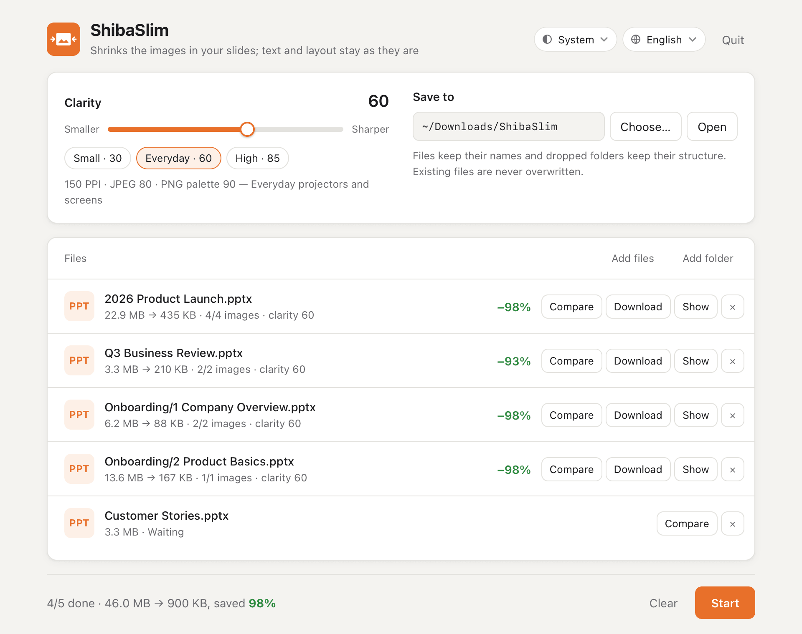

<p align="center">
  
</p>

<h1 align="center">ShibaSlim</h1>

<p align="center">
  <b>Shrink the images in your PowerPoint files to just what they need</b><br>
  Much smaller files, no visible difference, and text, layout and animations untouched.
</p>

<p align="center">
  
  
  
</p>

<p align="center">
  <a href="README.md">简体中文</a> · <b>English</b>
</p>

<p align="center">
  <picture>
    <source media="(prefers-color-scheme: dark)" srcset="docs/gui-en-dark.png">
    
  </picture>
  <br>
  <sub>The files in the screenshot are generated demo decks; real savings depend on the original images.</sub>
</p>

> [!NOTE]
> The interface and the comparison page follow your system language (Chinese or English) and theme. Command-line messages are currently in Chinese only.

## Features

- **Sized to how images are shown**: works out how large each image actually appears on its slides and keeps only the pixels needed, accounting for crops and group scaling.
- **One clarity setting**: a single number from 1 to 100 sets resolution, JPEG quality and PNG colour reduction together.
- **Before/after comparison**: picks a few random slides and lets you drag a divider between the original and the compressed version, with up to 4× zoom.
- **Desktop app, web page and CLI**: install the app and double-click, with no Node.js needed, and share it as a single file; or use it in a browser, or batch-process folders from the command line.
- **Light or dark, Chinese or English**: the pages follow your system's theme and language by default, and you can switch either at the top right; your choice is remembered.
- **Your files are safe**: originals are left alone by default and results are saved as new files; the graphical interface never overwrites an existing file. Every result is re-read and checked before it is written.
- **Runs locally**: nothing is uploaded to the internet. Works on macOS, Windows and Linux.

## Quick start

### Desktop app (recommended)

Download the installer for your system from [Releases](https://github.com/Wonvy/ShibaSlim/releases) and open ShibaSlim like any other app. Nothing else, not even Node.js, needs to be installed.

| System | Which file |
|---|---|
| macOS · Apple silicon (M1 and later) | the `.dmg` with `aarch64` in its name |
| macOS · Intel | the `.dmg` with `x64` in its name |
| Windows 10 / 11 | `x64-setup.exe` |
| Linux | `.AppImage` (runs as is) or `.deb` (Debian / Ubuntu package) |

> [!IMPORTANT]
> The installers are not yet notarized by Apple or code-signed for Windows, so the system stops the first launch. Allow it once and it will not ask again:
> - **macOS**: when it says the app cannot be opened, click **Done**, then go to **System Settings → Privacy & Security** and click **Open Anyway** near the bottom.
> - **Windows**: when you see "Windows protected your PC", click **More info → Run anyway**.
> - **Linux**: make the AppImage executable (`chmod +x`) before running it; if it complains about FUSE, install `libfuse2` (`libfuse2t64` from Ubuntu 24.04 on).

### From source (in a browser)

Install [Node.js](https://nodejs.org) 20.9 or later first.

```bash
git clone https://github.com/Wonvy/ShibaSlim.git
cd ShibaSlim
npm install
```

Then open the interface either way:

| How | What to do |
|---|---|
| Double-click | `ShibaSlim.command` on macOS, `ShibaSlim.cmd` on Windows, or run `ShibaSlim.sh` on Linux |
| Command line | `npm run gui` |

> [!TIP]
> The double-click launchers run `npm install` on first use, so you can also double-click them straight after downloading. If macOS says it cannot verify the developer, right-click the file and choose Open.

## Graphical interface

The ShibaSlim page opens in your browser:

1. Drag PowerPoint files or whole folders onto the page, or use **Choose files** / **Choose folder**. Folders are added with all their sub-folders.
2. Move the **Clarity** slider, or pick **Small**, **Everyday** or **High**.
3. To check the result first, click **Compare** next to a file. The comparison opens in a new tab; this is only a trial run and saves nothing.
4. Click **Start**. When a file is done, use **Download**, or **Show** to find it in its folder.

The desktop app shows the same interface with a few differences: **Compare** opens in a new window; results are already saved in the **Save to** folder, where **Show** finds them, so there is no **Download** button; and closing the window quits, so there is no **Quit** button.

The switches at the top right set the theme (System / Light / Dark) and language (System / 中文 / English). Both follow the system by default and change along with it; a choice you make is remembered, and the comparison page uses it too.

Results go to `Downloads/ShibaSlim` by default; you can change this on the page. Files keep their original names, and dropped folders keep their structure. If a file of the same name is already there, the result is saved as `name (2).pptx` instead.

> [!NOTE]
> The page is served only on `127.0.0.1` and its address carries a one-time access token, so other computers and other websites cannot reach it. Dropped files are copied to the system temp folder and deleted when you quit. Click **Quit** at the top right when you are done, or simply close the terminal window.

`shibaslim gui` takes two options: `--port <port>` to choose the port (51735 by default, or any free port if that one is taken) and `--no-browser` to print the address without opening a browser.

## Comparison page

<p align="center">
  <picture>
    <source media="(prefers-color-scheme: dark)" srcset="docs/compare-en-dark.jpg">
    
  </picture>
</p>

The comparison page picks a few random slides whose images changed and draws the images where they sit on each slide. **The original is on the left and the compressed version on the right**; drag anywhere on the slide to move the divider.

- Zoom to 2× or 4×; the view centres on the divider.
- Click **Original** at the top left or **Compressed** at the top right to switch the whole slide. Flicking between them is the easiest way to spot a difference.
- With the slide focused, <kbd>←</kbd> <kbd>→</kbd> move the divider (hold <kbd>Shift</kbd> for fine steps) and <kbd>Home</kbd> / <kbd>End</kbd> jump to either side.
- A table under each slide lists every image's size before and after.
- The page is a single self-contained HTML file with the images embedded, so you can send it to someone; it opens in their own system's theme and language.

> [!NOTE]
> Only images are drawn. Text, shapes and charts are identical before and after, so they are left out and the page looks emptier than the real slide.

## Clarity

| Clarity | Pixel density | JPEG quality | PNG | Good for |
|:---:|:---:|:---:|:---:|---|
| 30 · Small | 96 PPI | 68 | Reduced colours, quality 70 | Email attachments, just legible |
| **60 · Everyday (default)** | **150 PPI** | **80** | **Reduced colours, quality 90** | **Projectors, ordinary screens, sharing** |
| 85 · High | 220 PPI | 88 | Lossless | High-resolution displays, zooming in on detail |
| 100 | 330 PPI | 95 | Lossless | Barely downsampled; only invisible re-encoding |

Values in between are interpolated linearly, and from 85 up PNG is always lossless. Pixel density means how many pixels are kept for the size an image is **actually shown** on the slide: at 150 PPI a 16:9 slide is about 2000×1125, plenty for a 1080p projector.

> [!TIP]
> Not sure what to pick? Generate a comparison page at the default of 60, then go up or down from there.

## Command line

```bash
npm link    # optional: registers the global shibaslim command; otherwise use node dist/cli.js
```

```bash
# Compress one file, writing report.slim.pptx next to it (the original is untouched)
shibaslim report.pptx

# Choose a different clarity
shibaslim report.pptx -c 80

# Try it out first: write only the comparison page, no pptx
shibaslim report.pptx -c 40 -n --preview

# Process a folder recursively into another folder (names and structure kept)
shibaslim ./slides -r -o ./slides-compressed

# Glob patterns (expanded by the tool itself, so they work on Windows too)
shibaslim "*.pptx" -c 40
```

When scanning folders, Office lock files starting with `~$` and earlier `*.slim.*` outputs are skipped.

<details>
<summary><b>All options</b></summary>

| Option | Description |
|---|---|
| `-c, --clarity <1-100>` | Clarity, default 60 |
| `-p, --preset <name>` | Clarity shortcuts: `max` = 30, `balanced` = 60, `hq` = 85 |
| `--preview` | Also write a comparison page (e.g. `report.slim.preview.html`) |
| `--preview-pages <n>` | Slides on the comparison page, default 3; re-randomised every time |
| `-o, --out-dir <dir>` | Output folder |
| `--suffix <suffix>` | Output name suffix, default `.slim`; none by default with `--out-dir` |
| `--in-place` | Overwrite the originals. Compression is lossy and this cannot be undone, so back up first |
| `-n, --dry-run` | Report the savings without writing any pptx (a `--preview` page is still written) |
| `-r, --recursive` | Include sub-folders |
| `-j, --jobs <n>` | Files processed at once, default 1 |
| `-v, --verbose` | List what happened to each image |
| `--json` | Print results as JSON for scripts |

Advanced options override one value derived from the clarity; you will rarely need them:

| Option | Description |
|---|---|
| `--ppi <number>` | Pixel density |
| `-q, --quality <1-100>` | JPEG quality |
| `--png-quality <0-100>` | PNG colour-reduction quality; `0` means lossless |
| `--keep-png` | Never convert PNG to JPEG |
| `--strip-thumbnail` | Remove the preview thumbnail shown by file managers |

Exit codes: `0` when everything succeeded, `1` when a file failed, `2` for invalid arguments.

</details>

## How it works

A pptx file is a zip archive, and most of its size is the images in `ppt/media/`. ShibaSlim does four things:

1. **Downsamples images to their displayed size**: reads how large each image is shown on slides, layouts and masters, accounting for crops and group scaling. An image used in several places is sized for the largest one.
2. **Re-encodes**: JPEGs are recompressed with mozjpeg. An opaque PNG becomes a JPEG when that is clearly smaller; otherwise it stays PNG with reduced colours. PNGs with transparency always stay PNG.
3. **Merges duplicate images** and removes media that no slide uses.
4. **Repackages** the file, compressing XML and other parts at the highest level.

When an image changes format its extension changes too, so every `.rels` reference and `[Content_Types].xml` are updated to match. Before anything is written, the result is read back and checked; if the check fails, nothing is written.

<details>
<summary><b>What is never changed</b></summary>

- The slide XML itself: text, layout, animations and so on
- Vector images (EMF, WMF, SVG), GIFs, video and audio
- Images that use "Set Transparent Color", which relies on exact pixel values that lossy compression would break
- Tiled image fills are re-encoded but not downsampled
- Images that would shrink by less than 10% are kept as they are, so running the tool again on a compressed file does not degrade it further

</details>

## Known limitations

- Cropped-away parts of an image stay in the file. Resolution is based on the visible part, so nothing gets blurry, but that part of the size is not saved.
- Images with a zoom animation may look soft once zoomed. Use a higher clarity for such files, for example `-c 85`.
- Video and audio are not compressed.
- Encrypted pptx files and legacy `.ppt` files cannot be processed.

## Use as a library

```js
import { optimizeFile, optimizeBuffer } from 'shibaslim';

const report = await optimizeFile('in.pptx', 'out.pptx', {
  clarity: 70,
  previewPath: 'out.preview.html', // optional: also write a comparison page
});
console.log(report.before, report.after);

const { output } = await optimizeBuffer(buffer, { clarity: 40 });
```

## Development

```bash
npm test
```

The tests build presentations covering many cases with pptxgenjs on the fly, with no external files. The local server behind the interface is tested too (token and Host checks, uploads, compression, never overwriting existing files and more); the page itself was checked by hand in a browser.

### Building the desktop app

The desktop app uses [Tauri](https://tauri.app) for its window and ships its own copy of the official Node.js runtime, which runs exactly the same engine as `shibaslim gui` (again served only on `127.0.0.1`). That is why users do not need to install anything. Building it needs Node.js and [Rust](https://rustup.rs); on Linux, also the [system libraries Tauri lists](https://tauri.app/start/prerequisites/).

```bash
npm run desktop:dev      # open the desktop window in development mode
npm run desktop:build    # build installers for this system into src-tauri/target/release/bundle/
```

Before bundling, `desktop/stage.mjs` runs automatically: it compiles the TypeScript, installs sharp's native library for the target platform, and downloads the same Node.js version from nodejs.org, checking its SHA-256. An Apple silicon Mac can also build the Intel version: `npm run desktop:build -- --target x86_64-apple-darwin` (output in `src-tauri/target/x86_64-apple-darwin/release/bundle/`). After changing `docs/logo.svg`, run `node desktop/icons.mjs` to regenerate the app icons.

**Releasing a new version**: update the version in `package.json`, commit, and push a tag that starts with `v`:

```bash
git tag v0.2.0
git push origin v0.2.0
```

GitHub Actions then tests and builds on macOS (Apple silicon and Intel), Windows and Linux, and once all of them succeed it publishes a release for that version, which anyone can download from the Releases page.

Every push to `main` (except changes to READMEs or `docs/` only) is also built, with the installers attached to that run on the Actions tab (downloading them needs a GitHub login), so you can try a build before releasing it. You can also run "Desktop app" by hand from the Actions tab.

<details>
<summary><b>Code layout</b></summary>

| File | Role |
|---|---|
| `src/opc.ts` | Reads and writes the pptx package, keeping references and content types in sync |
| `src/usage.ts` | Works out the displayed size of every image |
| `src/images.ts` | Resizes and encodes a single image |
| `src/clarity.ts` | Maps clarity to concrete settings |
| `src/optimize.ts` | Runs the whole process: dedupe, clean up, compress, verify |
| `src/preview.ts` | Builds the before/after comparison page |
| `src/inputs.ts` | Expands files, folders and globs, and works out output paths |
| `src/cli.ts` | Command line and batch processing |
| `src/gui.ts` | Local server behind the interface: uploads, queue, progress updates |
| `src/messages.ts` | Chinese and English text for the pages, plus the theme and language switcher they share |
| `gui/` | The interface page (HTML, CSS, JS, no build step) |
| `desktop/engine.mjs` | Entry point of the engine inside the desktop app: starts the local server and talks to the window over stdio |
| `desktop/stage.mjs` | Prepares the engine files, plus Node.js and sharp for the target platform, before bundling |
| `src-tauri/` | The desktop app's shell (Rust / Tauri): starts the engine, shows the page, opens comparison windows |

</details>
