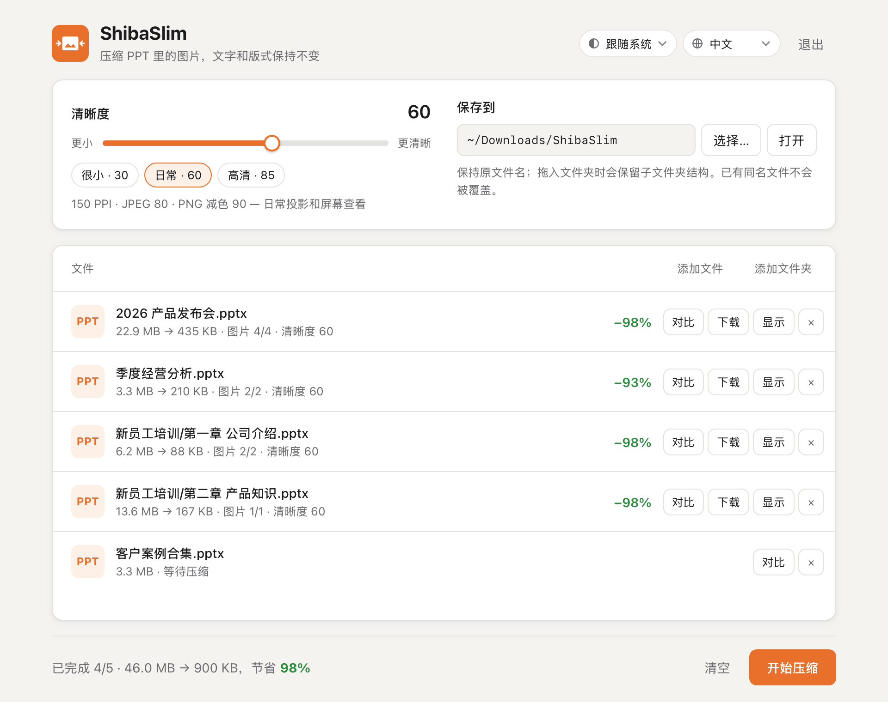
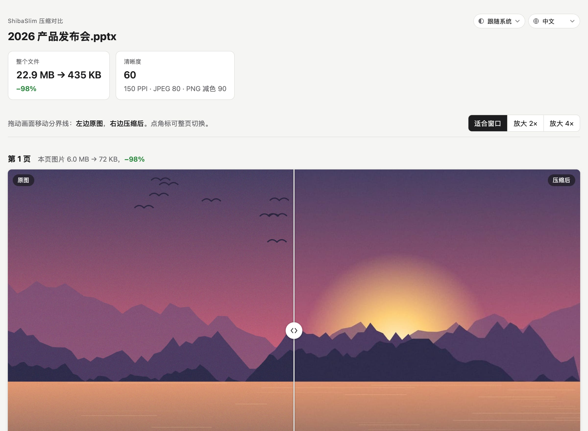

<p align="center">
  
</p>

<h1 align="center">ShibaSlim</h1>

<p align="center">
  <b>把 PPT 里的图片压到刚好够用</b><br>
  文件小很多，画面几乎看不出区别；文字、版式和动画原样保留。
</p>

<p align="center">
  
  
  
</p>

<p align="center">
  <b>简体中文</b> · <a href="README.en.md">English</a>
</p>

<p align="center">
  <picture>
    <source media="(prefers-color-scheme: dark)" srcset="docs/gui-zh-dark.png">
    
  </picture>
  <br>
  <sub>截图中的文件是用程序生成的演示文稿，实际能省多少取决于原图。</sub>
</p>

## 特点

- **按显示尺寸缩图**：读取每张图片在幻灯片上实际显示多大，只保留需要的像素，裁剪和组合缩放都会算进去。
- **一个清晰度参数**：1–100 一个数字，同时调好分辨率、JPEG 质量和 PNG 减色，不用研究参数。
- **压缩前后对比**：随机抽几页，左右拖动分界线对比原图和压缩后，可以放大到 4 倍看细节。
- **导出每页图片**：把每一页（或者只是封面、指定的几页）存成 PNG 或 JPG，宽度可以自己定。Windows 上用已经装好的 PowerPoint 或 WPS，Mac 上用 PowerPoint，没有的话用系统自带的快速查看。
- **桌面版、网页版和命令行**：下载安装包双击就能用，不用装 Node.js，发给别人也只是一个文件；也可以在浏览器里用，或者用命令行批量处理目录。
- **在线更新**：桌面版启动时会检查有没有新版本，点一下就自动下载、安装并重新打开。
- **浅色 / 深色，中文 / English**：页面默认跟随系统的主题和语言，也可以在右上角手动切换，选择会被记住。
- **不会弄丢文件**：默认不动原文件，结果另存为新文件；图形界面从不覆盖已有文件。每次写出前都会重新读取结果校验一遍。
- **可选署名**：把作者和公司写进文件属性，在选择窗格里每个图层的名字后面加上署名，并用本机密钥签名；之后随时能校验文件在签名后有没有被改动过。
- **本机运行**：文件不会上传到网络，macOS、Windows、Linux 通用。

## 快速开始

### 桌面版（推荐）

到 [Releases](https://github.com/Wonvy/ShibaSlim/releases) 下载对应系统的安装包，装好后像普通软件一样打开。电脑上不需要装 Node.js 或其他任何东西。

| 系统 | 下载哪个 |
|---|---|
| macOS · Apple 芯片（M1 及以后） | 文件名带 `aarch64` 的 `.dmg` |
| macOS · Intel 芯片 | 文件名带 `x64` 的 `.dmg` |
| Windows 10 / 11 | `x64-setup.exe` |
| Linux | `.AppImage`（直接运行）或 `.deb`（Debian / Ubuntu 安装包） |

> [!IMPORTANT]
> 安装包还没有经过苹果公证和 Windows 代码签名，第一次打开时系统会拦一下，放行一次以后就不会再问：
> - **macOS**：提示无法打开时先点“完成”，然后打开 **系统设置 → 隐私与安全性**，在页面下方点 **仍要打开**。
> - **Windows**：出现“Windows 已保护你的电脑”时，点 **更多信息 → 仍要运行**。
> - **Linux**：AppImage 要先 `chmod +x` 再运行；如果提示缺少 FUSE，安装 `libfuse2`（Ubuntu 24.04 起叫 `libfuse2t64`）。

### 从源码运行（网页版）

需要先安装 [Node.js](https://nodejs.org) 20.9 或更高版本。

```bash
git clone https://github.com/Wonvy/ShibaSlim.git
cd ShibaSlim
npm install
```

然后任选一种方式打开图形界面：

| 方式 | 操作 |
|---|---|
| 双击启动 | macOS 双击 `ShibaSlim.command`，Windows 双击 `ShibaSlim.cmd`，Linux 运行 `ShibaSlim.sh` |
| 命令行 | `npm run gui` |

> [!TIP]
> 双击启动的文件在首次运行时会自动执行 `npm install`，所以下载代码后也可以直接双击。macOS 如果提示“无法验证开发者”，右键点击文件选“打开”即可。

## 图形界面

启动后会在浏览器里打开 ShibaSlim 页面：

1. 把 PPT 文件或整个文件夹拖进页面，也可以点“选择文件”“选择文件夹”。文件夹会连同子文件夹一起添加。
2. 勾选要做的事：**压缩图片**、**署名**、**导出每页图片**，可以任意组合，比如只导出图片，或者压缩的同时署名。每一项的设置就在它的右边，不勾选时收起。
3. 压缩图片时，拖动清晰度滑块，或者点“很小 / 日常 / 高清”。想先看效果，就点文件右侧的“对比”按钮，会打开对比页面。这一步只是试压，不保存任何文件。
4. 点“开始”。完成后可以直接“下载”，或者点“显示”在文件夹中找到它。

署名要填写作者（公司可选），见[署名](#署名可选)。导出每页图片可以设置图片宽度（1280、1920、2560、3840 或自定义像素）、格式（PNG / JPG）和导出哪些页（全部、只导出封面，或者指定页码如 `1-3, 5`），见[导出每页图片](#导出每页图片)。只想马上导出某一个文件的图片，也可以点它右侧的“图片”。

鼠标停在某一项设置上，底部的状态栏会显示它的说明，比如当前清晰度对应的 PPI 和 JPEG 质量。文件右侧的按钮（对比、图片、显示、下载、移除）是小图标，鼠标停在上面会显示名称；文件下面一行只写结果的要点，停在上面能看到全部细节和保存位置。

设置改了以后，已完成的文件会显示“设置已更改，待重新处理”，再点“开始”就会按新设置重做。

桌面版和网页版是同一个界面，只有几处不同：结果默认保存在原文件旁边（见下文）；“对比”会先在后台生成好，再在新窗口里打开；结果已经直接保存好，点“显示”就能找到，所以没有“下载”按钮；关掉窗口就是退出，也就没有“退出”按钮，那个位置换成了“检查更新”。桌面版的窗口、菜单和对话框也跟随系统的语言和深浅色。

桌面版每次启动后会检查一次新版本，有的话会弹出提示，点“现在更新”就会下载、安装并自动重新打开。不想等启动时检查，可以点页面右上角的“检查更新”，macOS 上也可以用菜单 **ShibaSlim → 检查更新…**。

页面右上角可以切换主题（跟随系统 / 浅色 / 深色）和语言（跟随系统 / 中文 / English）。默认都跟随系统，系统设置改变时页面会实时跟着变；手动选择后会被记住，对比页面也会沿用同样的选择。

桌面版默认把结果保存在**原文件旁边的 `ShibaSlim` 文件夹**里，原文件不动：

```
项目资料/
├── 汇报.pptx              ← 原文件
└── ShibaSlim/
    ├── 汇报.slim.pptx     ← 压缩（和署名）后的文件
    └── 汇报-slides/       ← 每页图片
        ├── 01.png
        └── 02.png
```

也可以在“保存到”里改成“指定文件夹”，所有结果都放到那里，拖入文件夹时保留原来的目录结构。网页版（`shibaslim gui`）从浏览器里拿不到文件原来的位置，只能保存到指定文件夹，默认是 `下载/ShibaSlim`。

压缩后的文件名会在原名后加上 `.slim`（如 `汇报.pptx` → `汇报.slim.pptx`），只署名的加上 `.signed`，不会和原文件混淆。如果保存位置里已有同名文件，会另存为 `汇报.slim (2).pptx`，从不覆盖已有的文件。

> [!NOTE]
> 页面只在本机的 `127.0.0.1` 上提供，地址里带一次性的访问口令，其他电脑和其他网页都无法访问。拖进来的文件会先复制到系统临时文件夹，退出时自动删除。用完点页面右上角的“退出”，或者直接关掉终端窗口。

`shibaslim gui` 支持两个选项：`--port <端口>` 指定端口（默认 51735，被占用时自动换一个空闲端口），`--no-browser` 只打印地址、不自动打开浏览器。

## 对比页面

<p align="center">
  <picture>
    <source media="(prefers-color-scheme: dark)" srcset="docs/compare-zh-dark.jpg">
    
  </picture>
</p>

对比页面随机抽取几页图片有变化的幻灯片，按图片在页面上的实际位置画出来。**左边是原图，右边是压缩后**，拖动画面即可移动分界线。

- 可以放大到 2× 或 4×，放大时自动对准分界线。
- 点左上角的“原图”或右上角的“压缩后”可以整页切换，来回切换最容易看出差别。
- 选中画面后，可以用 <kbd>←</kbd> <kbd>→</kbd> 移动分界线，按住 <kbd>Shift</kbd> 微调，<kbd>Home</kbd> / <kbd>End</kbd> 直接跳到两端。
- 每页下方的表格列出每张图片压缩前后的尺寸和大小。
- 页面是一个独立的 HTML 文件，图片都内嵌在里面，可以直接发给别人看；对方打开时同样会按自己系统的主题和语言显示。

> [!NOTE]
> 对比页面只画图片。文字、形状和图表在压缩前后完全一样，所以没有画出来，页面会比真实的幻灯片显得空一些。

## 导出每页图片

在图形界面里勾选“导出每页图片”再点“开始”（或者点文件右侧的“图片”马上导出这一个），或者用命令行 `shibaslim images`，就能把幻灯片存成图片，放在 `<名称>-slides` 文件夹里，以页码命名（如 `汇报.pptx` → `汇报-slides/01.png、02.png…`）。图形界面把这个文件夹和压缩结果放在一起（桌面版默认是原文件旁边的 `ShibaSlim` 文件夹）；命令行默认放在原文件旁边。导出的是原文件，不是压缩后的文件；隐藏的幻灯片也会导出，也占页码。

可以只导出一部分：图形界面里选“只导出封面”或者“指定页”（如 `1-3, 5`），命令行用 `-p 1` 或 `-p 1-3,5`。图片仍以页码命名，比如只导出第 2、5 页，得到的是 `02.png` 和 `05.png`。超出文件页数的页码会被忽略。

pptx 文件里并没有存每一页的图片，需要有程序把幻灯片画出来。ShibaSlim 会自动选择这台电脑上最好的一个，失败时换下一个：

| 系统 | 用什么画 | 说明 |
|---|---|---|
| Windows | Microsoft PowerPoint，其次 WPS Office | 需要已经安装其中一个，效果和在 PowerPoint 里另存为图片一样 |
| macOS | Microsoft PowerPoint（已安装时） | 先存成 PDF，再按指定宽度画成图片。第一次使用时，系统会询问是否允许 ShibaSlim 控制 PowerPoint，PowerPoint 也可能询问能否访问 `~/Library/Caches/ShibaSlim/PowerPoint` 文件夹，都选允许即可，之后不再询问 |
| macOS | 系统自带的快速查看（Quick Look） | 不用安装任何软件，速度很快。效果接近 PowerPoint，但部分图片效果（如改成灰度）和透明度会丢失 |
| Linux | 暂不支持 | |

导出时 PowerPoint 和 WPS 在后台打开一份临时副本，不会改动原文件；如果它们原本没有在运行，导出完会自动退出。

```bash
shibaslim images 汇报.pptx                       # 生成 汇报-slides/01.png、02.png…
shibaslim images ./课件 -r -w 1280 --format jpg   # 整个目录，1280 像素宽的 JPG
shibaslim images 汇报.pptx -p 1                  # 只导出封面
shibaslim images 汇报.pptx --renderer quicklook  # 指定用快速查看
```

| 选项 | 说明 |
|---|---|
| `-w, --width <像素>` | 图片宽度，默认 1920（16:9 的幻灯片即 1920×1080），高度按幻灯片比例 |
| `--format <png\|jpg>` | 图片格式，默认 png |
| `-q, --quality <1-100>` | jpg 的质量，默认 90 |
| `-p, --pages <页码>` | 只导出这些页，如 `1` 或 `1-3,5`；默认全部 |
| `--renderer <名称>` | 只用这一个：`powerpoint`、`wps` 或 `quicklook` |
| `-o, --out-dir <目录>` | 输出目录（保持子目录结构）；默认放在原文件旁边 |
| `-r, --recursive` / `--json` | 递归处理子目录 / 以 JSON 输出结果 |

再次导出同一个文件时，命令行会替换 `<名称>-slides` 里之前导出的图片（只删 `01.png` 这样以数字命名的图片，其他文件不动）；图形界面则和压缩结果一样，从不覆盖不是这次打开后写的文件夹，会另存为 `汇报-slides (2)`。

## 清晰度

| 清晰度 | 像素密度 | JPEG 质量 | PNG | 适合 |
|:---:|:---:|:---:|:---:|---|
| 30 · 很小 | 96 PPI | 68 | 减色，质量 70 | 邮件附件，能看清就行 |
| **60 · 日常（默认）** | **150 PPI** | **80** | **减色，质量 90** | **投影、普通屏幕、日常分享** |
| 85 · 高清 | 220 PPI | 88 | 无损 | 高分屏展示，需要放大看细节 |
| 100 | 330 PPI | 95 | 无损 | 几乎不缩小，只做看不出差别的重新编码 |

中间的数值按上表线性过渡，85 及以上时 PNG 一律无损。像素密度是指按图片在幻灯片上的**实际显示尺寸**保留多少像素。比如 16:9 的幻灯片在 150 PPI 下相当于 2000×1125，足够 1080p 投影使用。

> [!TIP]
> 拿不准用多少时，先用默认的 60 生成对比页面看看，再决定往高调还是往低调。

## 署名（可选）

在界面上勾选“署名”并填写作者（公司可选），或者在命令行加 `--author`，结果里会多出三样东西：

| 位置 | 写了什么 | 在哪里能看到 |
|---|---|---|
| 文件属性（`docProps/core.xml`、`docProps/app.xml`） | 作者、最后一次保存者、公司 | Windows 右键 → 属性 → 详细信息；PowerPoint“文件 → 信息”；macOS 的 Spotlight（`mdls 文件.pptx`） |
| 每页的选择窗格（`ppt/slides/*.xml`） | 每个图层的名字后面加上 ` · © 张三`，如 `图片 3 · © 张三`；组合和组合里的图层也一样 | PowerPoint“开始 → 排列 → 选择窗格”（<kbd>Alt</kbd>+<kbd>F10</kbd>），动画窗格里也显示这些名字 |
| 演示文稿标签（`ppt/tags/*.xml`） | 作者、签名时间、公钥和 Ed25519 签名 | 界面上看不到，用 ShibaSlim 校验 |

不会新增任何图层，只改名字，放映和打印的内容不变。动画按形状编号引用对象，不受影响；“平滑切换”按名字配对前后两页的对象，每个名字加的后缀相同，配对也不变。已经署过名的文件再署一次，会替换名字后面原来的署名，不会越加越多。即使原来的署名格式被改过（比如点换成了全角“・”，或者空格没了），或者名字里已经叠了好几个署名，也只保留一个新的；没有点在前面的 ©（如 `© 2024 公司标志`）算名字本身，不会删掉。0.2.0 版加在每页上的隐藏署名形状也会顺便删掉。母版和版式里的图层不改。

如果 `.pptm` 里的宏按名字找形状（如 `Shapes("图片 3")`），改名后会找不到，这类文件请先确认再署名。

已经压缩过的文件不必再压一遍：界面里只勾选“署名”、不勾“压缩图片”，或者用 `shibaslim sign`。图片和其他媒体原样保留，只写入上面三样，结果文件名加上 `.signed`（如 `汇报.slim.signed.pptx`）。

签名覆盖包里的每一个部件。签名之后文件有任何改动，包括用 PowerPoint 打开再保存一次，签名都会对不上。校验方法：

- **界面**：把文件拖进来，文件名下方会显示“✓ 本机签名有效”“✓ 张三 的签名有效”或“⚠ 张三 签名后被改动过”。
- **命令行**：`shibaslim verify 汇报.slim.pptx`，全部有效时退出码为 0。

签名用的是本机密钥，第一次署名时自动生成，只有当前用户能读取：

| 系统 | 位置 |
|---|---|
| macOS | `~/Library/Application Support/ShibaSlim/signing-key.pem` |
| Windows | `%APPDATA%\ShibaSlim\signing-key.pem` |
| Linux | `~/.config/shibaslim/signing-key.pem` |

换电脑时把这个文件一起复制过去，签名才会继续显示为“本机签名”。团队想共用一把密钥，可以用 `--sign-key` 指定，或者设置环境变量 `SHIBASLIM_KEY_FILE`。

> [!IMPORTANT]
> 署名用来记录，不是保护：PowerPoint 的“检查文档”可以一键清除文件属性，图层名字可以手动改回去，懂行的人解压后也能删掉标签。签名能证明的是“这份文件签名后没有被改过，签名用的是某一把密钥”，并不能证明签名的人是谁，别人完全可以用自己的密钥另签一份。需要 Office 认可的“已签名”标志时，请在压缩之后再用 PowerPoint 的“保护演示文稿 → 添加数字签名”。

## 命令行

```bash
npm link    # 可选：注册全局命令 shibaslim；不注册的话用 node dist/cli.js 代替
```

```bash
# 压缩一个文件，在旁边生成 汇报.slim.pptx（原文件不变）
shibaslim 汇报.pptx

# 换个清晰度
shibaslim 汇报.pptx -c 80

# 先试试效果：只生成对比页面，不写 pptx
shibaslim 汇报.pptx -c 40 -n --preview

# 递归处理整个目录，输出到另一个目录（保持文件名和目录结构）
shibaslim ./课件 -r -o ./课件-压缩版

# 通配符（由工具自己展开，Windows 下也能用）
shibaslim "*.pptx" -c 40

# 压缩并署名、签名
shibaslim 汇报.pptx --author 张三 --company 柴犬工作室

# 已经压缩过的文件只署名，不再压缩图片（生成 汇报.slim.signed.pptx）
shibaslim sign 汇报.slim.pptx --author 张三

# 校验署名：签名后有没有被改动过
shibaslim verify 汇报.slim.pptx

# 把每一页导出成图片（见“导出每页图片”）
shibaslim images 汇报.pptx
```

扫描目录时会跳过 `~$` 开头的 Office 临时文件，以及之前生成的 `*.slim.*` 文件。

<details>
<summary><b>全部选项</b></summary>

| 选项 | 说明 |
|---|---|
| `-c, --clarity <1-100>` | 清晰度，默认 60 |
| `-p, --preset <名称>` | 清晰度的别名：`max` = 30、`balanced` = 60、`hq` = 85 |
| `--preview` | 同时生成对比页面（如 `汇报.slim.preview.html`） |
| `--preview-pages <n>` | 对比页面抽取的页数，默认 3；每次生成都会重新随机 |
| `-o, --out-dir <目录>` | 输出目录 |
| `--suffix <后缀>` | 输出文件名后缀，默认 `.slim`；指定 `--out-dir` 时默认不加 |
| `--in-place` | 直接覆盖原文件。压缩是有损的，覆盖后无法恢复，请先备份 |
| `-n, --dry-run` | 只报告能省多少，不写 pptx（`--preview` 的页面照常生成） |
| `-r, --recursive` | 递归处理子目录 |
| `-j, --jobs <n>` | 同时处理的文件数，默认 1 |
| `-v, --verbose` | 列出每张图片的处理结果 |
| `--json` | 以 JSON 格式输出结果，方便脚本调用 |
| `--author <名字>` | 署名并签名，见[署名](#署名可选) |
| `--company <名称>` | 同时写入文件属性里的公司 |
| `--sign-key <文件>` | 改用这个 Ed25519 私钥（PEM 格式）签名 |
| `--no-sign` | 只写署名，不签名 |

以下高级选项会单独覆盖清晰度算出的某一项，一般用不到：

| 选项 | 说明 |
|---|---|
| `--ppi <数值>` | 像素密度 |
| `-q, --quality <1-100>` | JPEG 质量 |
| `--png-quality <0-100>` | PNG 减色质量，`0` 表示无损 |
| `--keep-png` | 不把 PNG 转成 JPEG |
| `--strip-thumbnail` | 删除文件管理器里显示的预览缩略图 |

退出码：全部成功为 `0`，有文件失败为 `1`，参数错误为 `2`。`shibaslim sign` 支持 `--author`（必填）、`--company`、`--sign-key`、`--no-sign`、`-o`、`--suffix`（默认 `.signed`）、`--in-place`、`-r`、`-j` 和 `--json`。`shibaslim verify` 在全部签名有效时为 `0`，否则为 `1`；加 `--sign-key <文件>` 可以对照指定的密钥（私钥或公钥）判断是不是它签的。

</details>

## 工作原理

pptx 本质上是一个 zip 压缩包，体积大多来自 `ppt/media/` 里的图片。ShibaSlim 依次做四件事：

1. **按显示尺寸缩小图片**：读取幻灯片、版式和母版里每张图片的显示大小，考虑裁剪和组合缩放；同一张图用在多处时，按显示最大的那处来算。
2. **重新编码**：JPEG 用 mozjpeg 重新压缩。不带透明的 PNG，如果转成 JPEG 能明显变小就转，否则保持 PNG 并减色。带透明的 PNG 始终保持 PNG。
3. **合并重复图片**，删除没有任何页面用到的媒体文件。
4. **重新打包**，XML 等内容使用最高压缩级别。

图片转了格式，文件扩展名也要跟着改，工具会同步更新所有 `.rels` 引用和 `[Content_Types].xml`。写出前会重新读取一遍结果，校验不通过就不输出。

<details>
<summary><b>不会改动的内容</b></summary>

- 幻灯片本身的 XML，包括文字、版式、动画等（开启署名时，只在图层名字后面加上署名）
- 矢量图（EMF、WMF、SVG）、GIF、视频和音频
- 用了“设置透明色”的图片，因为它依赖精确的像素值，有损压缩会破坏效果
- 平铺填充的图片只重新编码，不缩小
- 压缩后省不到 10% 的图片保留原样，所以对压缩过的文件重复运行，画质不会继续下降

</details>

## 已知限制

- 被裁剪掉的图片区域仍然留在文件里。分辨率按可见部分计算，不会压糊，但这部分体积没有省下来。
- 带“放大”动画的图片，放大后可能不够清晰。这类文件建议调高清晰度，比如 `-c 85`。
- 不压缩视频和音频。
- 无法处理加密的 pptx 和旧版 `.ppt` 文件。
- 导出图片在 Linux 上暂不支持；用快速查看画出的图片和 PowerPoint 不完全一样。

## 作为库使用

```js
import { attributeFile, checkSignatureOf, optimizeFile, optimizeBuffer, renderSlides } from 'shibaslim';

const report = await optimizeFile('in.pptx', 'out.pptx', {
  clarity: 70,
  previewPath: 'out.preview.html', // 可选：同时生成对比页面
});
console.log(report.before, report.after);

const { output } = await optimizeBuffer(buffer, { clarity: 40 });

// 可选：署名并用本机密钥签名，之后校验
const signed = await optimizeBuffer(buffer, { attribution: { author: '张三', company: '柴犬工作室' } });
const check = await checkSignatureOf(signed.output); // check.status: 'valid' | 'modified' | 'invalid' | 'unsigned'

// 只署名，不压缩图片
await attributeFile('in.slim.pptx', 'in.slim.signed.pptx', { author: '张三' });

// 把每一页存成图片：out/01.png、02.png…
const { files, renderer } = await renderSlides('in.pptx', 'out', { width: 1920, format: 'png' });
```

## 开发

```bash
npm test
```

测试会用 pptxgenjs 现场生成各种情况的演示文稿，不依赖外部文件；图形界面的本地服务也有测试，覆盖口令和 Host 校验、上传、压缩、不覆盖已有文件等。页面本身是在浏览器里手动验证的。

### 打包桌面版

桌面版用 [Tauri](https://tauri.app) 做窗口，安装包里自带一份官方的 Node.js 运行时，跑的是和 `shibaslim gui` 完全相同的压缩引擎（同样只在 `127.0.0.1` 上提供），所以用户的电脑上什么都不用装。打包需要 Node.js 和 [Rust](https://rustup.rs)；Linux 还需要 [Tauri 列出的系统库](https://tauri.app/start/prerequisites/)。

```bash
npm run desktop:dev      # 以开发模式打开桌面窗口
npm run desktop:build    # 打包当前系统的安装包，输出到 src-tauri/target/release/bundle/
```

打包前会自动运行 `desktop/stage.mjs`：编译 TypeScript，按目标平台安装 sharp 的原生库，再从 nodejs.org 下载与当前相同版本的 Node.js 并校验 SHA-256。在 Apple 芯片的 Mac 上也能打 Intel 版：`npm run desktop:build -- --target x86_64-apple-darwin`（输出在 `src-tauri/target/x86_64-apple-darwin/release/bundle/`）。换了 `docs/logo.svg` 后运行 `node desktop/icons.mjs` 重新生成应用图标，运行 `node desktop/installer-art.mjs` 重新生成安装界面的图片（macOS 安装窗口的背景、Windows 安装器的侧边图和横幅）。

**在线更新的签名密钥**：更新包必须用私钥签名，App 用 `src-tauri/tauri.conf.json` 里的公钥验证后才会安装。私钥不进仓库，要放在 GitHub 上让 Actions 使用：

1. 生成密钥（只需一次）：`npx tauri signer generate -w ~/.tauri/shibaslim-updater.key`，并把生成的公钥填进 `tauri.conf.json` 的 `plugins.updater.pubkey`。
2. 打开仓库的 **Settings → Secrets and variables → Actions → New repository secret**，名字填 `TAURI_SIGNING_PRIVATE_KEY`，内容填私钥文件的全部内容（可以用 `pbcopy < ~/.tauri/shibaslim-updater.key` 复制）。如果生成时设了密码，再加一个 `TAURI_SIGNING_PRIVATE_KEY_PASSWORD`。
3. **备份好私钥**。丢了的话，已经装好的 App 就无法再验证新版本，只能让大家手动下载重装。

没有设置这个密钥时一切照常打包，只是那次的版本不会作为在线更新推送给已经安装的人。本机打一个带更新包的版本：`TAURI_SIGNING_PRIVATE_KEY=~/.tauri/shibaslim-updater.key npm run desktop:build -- --config src-tauri/tauri.updater.conf.json`。

**发布新版本**：改好 `package.json` 里的版本号并提交，然后推送一个 `v` 开头的标签：

```bash
git tag v0.2.0
git push origin v0.2.0
```

GitHub Actions 会在 macOS（Apple 芯片和 Intel）、Windows、Linux 上分别测试并打包，全部成功后自动发布这个版本的 Release，任何人都能在 Releases 页面下载。

平时每次推送到 `main`（只改 README 或 `docs/` 的除外）也会自动打包一次，安装包作为附件出现在 Actions 页面的这次运行里（需要登录 GitHub 才能下载），适合发布前先自己试用。也可以在 Actions 页面选 “Desktop app” 手动运行。

<details>
<summary><b>代码结构</b></summary>

| 文件 | 职责 |
|---|---|
| `src/opc.ts` | 读写 pptx 包，维护引用关系和内容类型 |
| `src/usage.ts` | 分析每张图片的显示尺寸 |
| `src/images.ts` | 单张图片的缩放与编码 |
| `src/clarity.ts` | 清晰度与具体参数的换算 |
| `src/optimize.ts` | 串起整个流程：去重、清理、压缩、校验 |
| `src/preview.ts` | 生成压缩前后的对比页面 |
| `src/inputs.ts` | 展开文件、目录和通配符，计算输出路径 |
| `src/cli.ts` | 命令行与批量处理 |
| `src/gui.ts` | 图形界面的本地服务：上传、排队压缩、进度推送 |
| `src/messages.ts` | 页面的中英文文案，以及两个页面共用的主题和语言切换脚本 |
| `gui/` | 图形界面的网页（HTML、CSS、JS，无需构建） |
| `desktop/engine.mjs` | 桌面版里引擎的入口：启动本地服务，通过标准输入输出和窗口通信 |
| `desktop/stage.mjs` | 打包前准备引擎文件，以及目标平台的 Node.js 和 sharp |
| `desktop/latest-json.mjs` | 发布时生成在线更新的清单 `latest.json` |
| `desktop/icons.mjs`、`desktop/installer-art.mjs` | 从 logo 生成应用图标和安装界面的图片 |
| `src-tauri/` | 桌面版的窗口外壳（Rust / Tauri）：启动引擎、显示页面、打开对比窗口、菜单和在线更新 |

</details>
